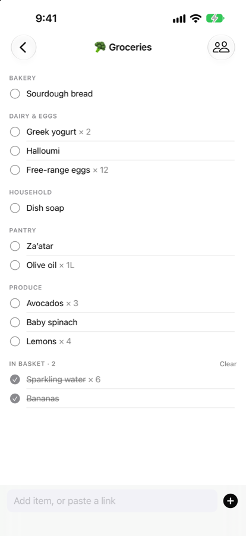
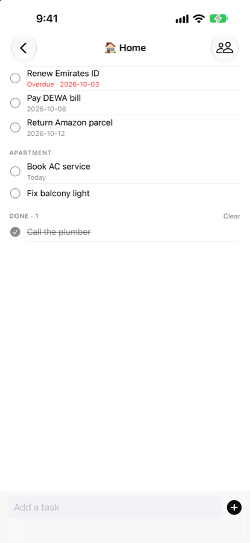
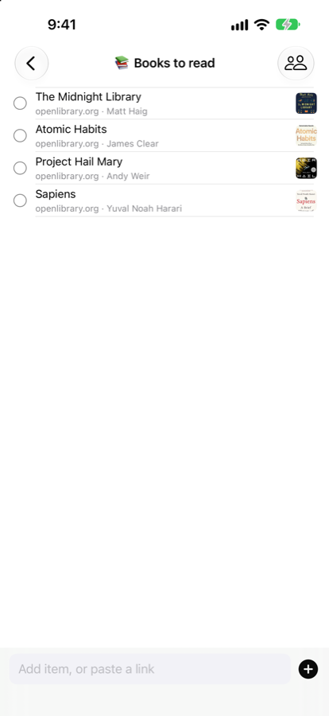
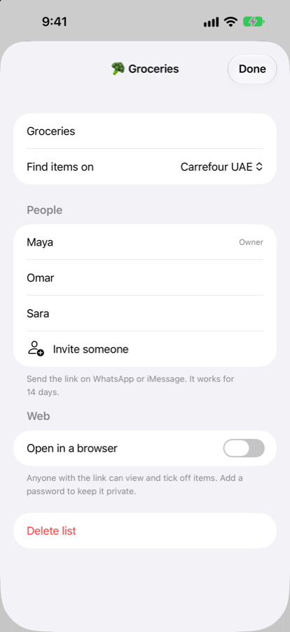

# ListAZ: Shared Lists

An iPhone app for the lists you share with the people you live with: groceries, books to read, gift ideas and home to-dos.

- Share any list with an invite link on WhatsApp or iMessage. Changes show up on everyone's phone instantly.
- Groceries sort themselves by supermarket aisle as you type.
- Paste a link from Amazon, noon or any shop and ListAZ pulls in the name, picture and price.
- To-do lists with due dates.
- Open a list in any browser, with an optional password, for people who don't have the app.
- Add items with Siri or the Share button.
- Connect your lists to your own AI assistant with a private MCP connector link.
- On iPhones with Apple Intelligence, turn a messy note or recipe into a clean list, privately on the device.

Sign in with Apple. No ads, no tracking, no emails.

The source code is private. Published by The Collective Mind.
